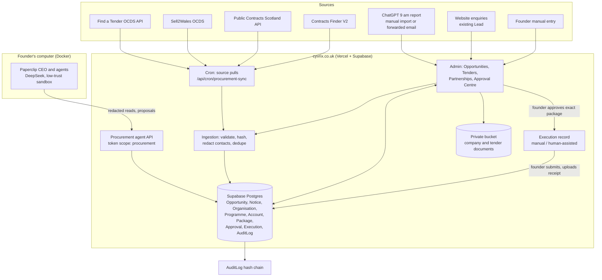
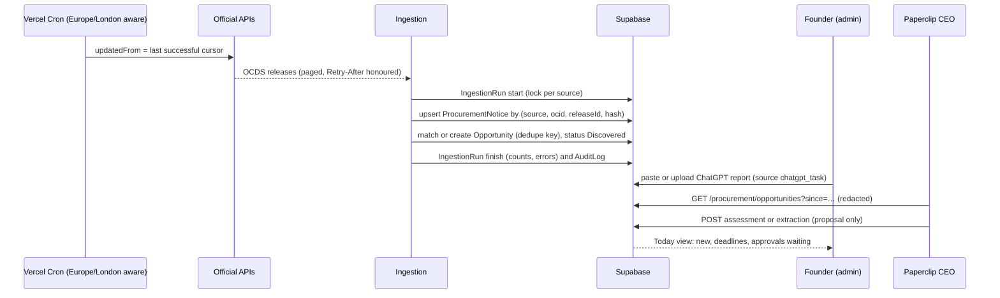
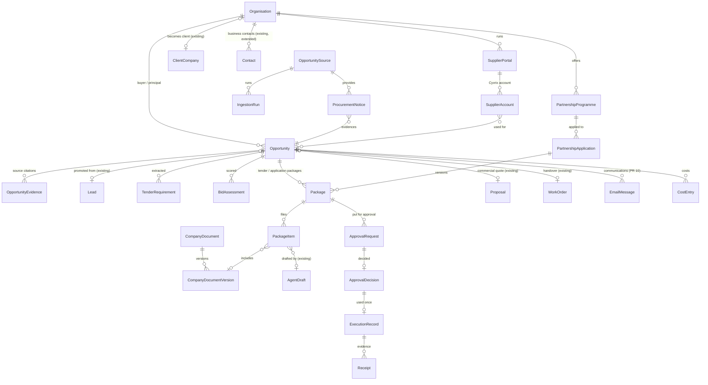

# 02. Proposed design

Principles, in priority order:

1. **The website is the system of record and the only place a binding approval
   exists.** Paperclip orchestrates work. It never holds approvals, credentials
   or personal data.
2. **Extend, do not duplicate.** Reuse `Lead`, `Contact`, `Proposal`,
   `WorkOrder`, `AgentDraft`, `EmailMessage`, `Notification` and `AuditLog`.
   New tables only where nothing exists.
3. **Gated states move only on a verified event, server-side.** No agent can
   reach `Submitted`, `Awarded`, `ApprovedPartner` or any `Approved*` state.
4. **Cheapest reliable path:** free official APIs, Vercel Cron for short pulls,
   Paperclip for research and drafting, people for anything binding.

## 1. Architecture



**Why this split:** Paperclip cannot be reached from the internet and runs only
when the PC is on (B8). So anything time-critical (source pulls, deadline
alerts) runs on Vercel. Agents pull work over HTTPS, as they do today.

## 2. Data flows

### 2.1 Daily intake



**Scheduling:** Vercel Cron runs in UTC. To get "before 09:00 London" in both
seasons, the cron fires at 06:00 and 07:00 UTC, and the handler runs only
when London local time is 07:00. The 07:00 UTC security scan is kept as is. A
second daily pull at 13:00 UTC catches midday notices. Deadline reminders come
from the same handler. ChatGPT import is completion-aware: it happens when the
report arrives, not at a fixed time.

**Deduplication key:** for official notices, the `ocid`. Across sources, a
normalised tuple of (buyer organisation, title tokens, deadline date, value
band), shown to a person as "possible duplicate", never merged silently.
ChatGPT and agent leads link to an `ocid` when they cite one.

### 2.2 Approval and execution

```mermaid
sequenceDiagram
    participant Ag as Paperclip agent
    participant API as Procurement API
    participant DB as CRM
    participant QA as Compliance checks
    participant F as Founder (2FA step-up)
    participant X as External portal

    Ag->>API: POST draft documents / answers (AgentDraft)
    API->>DB: store; claims rules run
    F->>DB: assemble Package version N (files hashed)
    DB->>QA: automatic checks (claims, mandatory items, deadline, duplicates)
    QA-->>DB: findings (block if any blocking finding)
    DB->>F: Approval Centre shows exact files, hashes, price, declarations, destination
    F->>DB: Approve with TOTP code (ApprovalDecision, expiry)
    F->>X: submits by hand (D8-A)
    F->>DB: upload receipt and reference
    DB->>DB: verify package hash matches approval, single use, then Submitted
    DB->>DB: AuditLog entries at each step
```

## 3. Entity relationship diagram (mapped to the current schema)

Existing tables are marked **(existing)**. Everything else is new, in
`public`, with row-level security on, no policies, and access only through the
server (the `AgentDraft` pattern).



### Key fields (logical, for Phase 1 review)

| Table | Purpose | Key fields |
| --- | --- | --- |
| `Organisation` | Any counterparty: buyer, principal contractor, manufacturer, distributor, target | `name`, `companiesHouseNo?`, `website`, `categories[]` (A–D from §32), `priority`, `isResearchTarget`, `clientCompanyId?`, `sourceUrl`, `verifiedAt?` |
| `OpportunitySource` | Source registry (§5) | `key` (fts, s2w, pcs, cf, chatgpt_task, openai_independent, paperclip, website, manual, supplier_portal), `enabled`, `cursor`, `lastSuccessAt`, `health`, `licence` |
| `IngestionRun` | One pull or import | `sourceId`, `startedAt`, `finishedAt`, `status`, `fetched`, `created`, `updated`, `errorClass`, `errorDetail` |
| `ProcurementNotice` | Raw OCDS release, immutable | `sourceId`, `ocid`, `releaseId`, `noticeId`, `stage`, `sha256`, `raw` (JSON, contact points removed), `fetchedAt` |
| `Opportunity` | The one pipeline record | `kind` (commercial, tender, partnership, assignment), `status` (state machine), `title`, `buyerOrganisationId`, `ocid?`, `deadlineAt?`, `clarificationDeadlineAt?`, `valueMin/Max?`, `currency`, `region`, `cpv[]`, `confirmedBuying` (vs inferred prospect), `origin` (source key), `paperclipIssueId?`, `leadId?` |
| `OpportunityEvidence` | Why we believe it | `opportunityId`, `url`, `retrievedAt`, `quote` (short), `kind` (notice, web, report, email) |
| `TenderRequirement` | §11 extraction | `opportunityId`, `category`, `text`, `mandatory`, `sourceRef` (document, page, section), `confidence`, `reviewedBy?` |
| `BidAssessment` | §12 / §40 scoring | `opportunityId`, `model` (bid or partnership), `weights` (JSON), `scores` (JSON), `disqualifiers[]`, `assumptions` (JSON), `recommendation`, `author` (agent or user) |
| `PartnershipProgramme` | §35–36 | `organisationId`, `categories[]`, `url`, `verified`, `fees?`, `requirements` (JSON), `status` |
| `PartnershipApplication` | §43 lifecycle | `programmeId`, `status`, `opportunityId?` |
| `SupplierPortal` / `SupplierAccount` | §8 registry | portal: `name`, `url`, `automationPermitted` (default false), `termsUrl`; account: `status`, `accountRef`, `registeredAt`, `verificationStatus`, `contactAlias`, **`credentialLabel`** (a password-manager entry name, never a secret), `mfaRequired`, `termsVersion`, `approvalId`, `renewalAt` |
| `CompanyDocument` / `CompanyDocumentVersion` | §9 knowledge base | `kind`, `classification`, `owner`, `status` (verified, ai_draft, founder_approved, certified_evidence, missing, expired), `effectiveAt`, `expiresAt?`, `storagePath`, `sha256`, `scanResult` |
| `CompanyFact` | Verified facts for forms | `key`, `value`, `evidenceDocumentId?`, `verifiedAt`, `publicAllowed` (false for the registered office) |
| `Package` / `PackageItem` | An exact set of files for one destination | `opportunityId` or `applicationId`, `version`, `destination`, `manifestSha256` (hash of the sorted item hashes plus price and declarations), `status` |
| `ApprovalRequest` / `ApprovalDecision` | §15 binding | see §5 below |
| `ExecutionRecord` / `Receipt` | §16 | `approvalDecisionId` **unique**, `mode` (manual, human_assisted, api, browser), `startedAt`, `outcome` (confirmed, rejected, ambiguous), `portalReference`, `receiptDocumentVersionId`, `submittedManifestSha256` |
| `CostEntry` | §23 | `date`, `agent?`, `integration?`, `opportunityId?`, `amountMinor`, `currency`, `basis` (measured or estimate) |

**State history** is not a new table. Each transition writes an `AuditLog`
entry (`action = "opportunity.transition"`, `entityId`, `metadata.from/to/
event`). That reuses the hash chain, so history cannot be rewritten quietly.

**Extended, not new:** `Contact` gains `organisationId?` and `source`.
`AgentDraft.kind` gains `outreach`, `tender_answer`, `document` and
`registration_pack`, keeping the claims gate. `Notification` is used as is.

## 4. Lifecycles, enforced server-side

`lib/procurement/lifecycle.ts` holds the two state machines from spec §14 and
§43 as data: `{from, to, event, actor}` rows. One function, `transition()`,
does the rest:

1. Checks that the move is listed and the actor type (user, agent, system) is
   allowed for it.
2. For gated targets, requires the named event record:
   - `ApprovedForSubmission` needs a current `ApprovalDecision`;
   - `Submitted` and `ApplicationSubmitted` need a `Receipt` on a confirmed
     `ExecutionRecord`;
   - `Awarded` and `ApprovedPartner` need an uploaded evidence document from
     the buyer or organisation.
3. Updates with a compare-and-set on the current status, so two writers cannot
   both move it.
4. Writes the `AuditLog` entry in the same transaction.

Agents can only request the transitions `Discovered→Validated` and
`Validated→Qualified`, plus assessment events. Everything else needs a signed-in
user.

## 5. Approval architecture

**Binding (spec §15 "Technical enforcement"):** an `ApprovalRequest` stores
`opportunityId`, `actionType` (submit_tender, submit_application, register_account,
send_email, send_quote, accept_contract, accept_assignment, spend),
`destination` (portal URL, or recipient address for email), `packageId`,
`manifestSha256`, `priceSnapshot`, `declarations` (verbatim text),
`expiresAt` (default seven days, never after the deadline) and `scope`.

**Deciding:** only a `SUPER_ADMIN` with two-factor enrolled, entering a fresh
TOTP code on the decision (step-up). This reuses `lib/two-factor.ts` and its
replay guard. The decision row copies the request's `manifestSha256`.

**Invalidation:** any change to a package item, the price or the declarations
produces a new manifest hash. The gateway compares hashes at execution, so a
stale approval fails closed. Expired approvals fail closed. A deadline moving
earlier than the expiry shortens it.

**Replay and duplicates:** `ExecutionRecord.approvalDecisionId` is unique, so
an approval is single-use. A partial unique index on `(opportunityId)` where
outcome is `confirmed` stops a second confirmed submission. An `ambiguous`
outcome blocks retries until a person reconciles it.

**Emails** (outreach, enquiries, quotations): the existing pattern stands. An
agent drafts in `AgentDraft`, the claims rules run, the founder approves, and
the Email page sends. The new part is a suppression check against
unsubscribed and objected addresses at send time.

**Paperclip:** agents keep raising `FOUNDER DECISION:` tasks for questions
("bid or no-bid?"). The answer can be recorded in Paperclip, but **it does not
authorise anything external**. Only the website approval does. The two are
linked by `paperclipIssueId`.

**Deadline pressure** (§21) raises the notification level. It never shortens
or skips approval.

## 6. Agent API and permission matrix

New token `PAPERCLIP_PROCUREMENT_TOKEN`, different from the read and draft
tokens. The startup check refuses it if it equals either of the others, the same
rule as today. Routes live under `/api/integrations/paperclip/procurement/`:

| Route | Returns or accepts | Personal data |
| --- | --- | --- |
| `GET opportunities?since&status&kind` | Opportunity, buyer organisation, deadlines, requirements, evidence URLs | **None**: contact points, names, emails and phones removed; ChatGPT text passed through redaction |
| `GET organisations?category` | The 52 targets and others, programmes, portals (no account references) | None |
| `POST assessments` | `BidAssessment` (proposal) | n/a |
| `POST requirements` | `TenderRequirement` rows with source references, `reviewedBy` null | n/a |
| `POST research` | A new opportunity or programme with evidence URLs; lands in `Discovered` | Refused if it contains an email, phone or a person-name pattern |
| `POST drafts` (existing) | Outreach and document drafts, addressed to a role ("Supplier Onboarding team") | n/a |

### Permission matrix

| Action | Founder (SUPER_ADMIN + 2FA) | Admin user | Paperclip agent (procurement token) | Cron / system |
| --- | --- | --- | --- | --- |
| Read opportunities (full) | ✓ | ✓ | redacted only | ✓ |
| Read contacts, emails, documents | ✓ | ✓ | ✗ | ✗ |
| Create opportunity / research item | ✓ | ✓ | ✓ (Discovered) | ✓ (from APIs) |
| Validate, qualify | ✓ | ✓ | request only | ✗ |
| Score, extract requirements | ✓ | ✓ | ✓ (proposal) | ✗ |
| Upload or approve company documents | ✓ | upload | ✗ | ✗ |
| Assemble package | ✓ | ✓ | ✗ (drafts only) | ✗ |
| Approve external action | ✓ | ✗ | ✗ | ✗ |
| Execute (submit, send, register) | ✓ (by hand) | send email after approval | ✗ | ✗ |
| Mark Submitted / Awarded / ApprovedPartner | evidence required | evidence required | ✗ | ✗ |
| Change sources, budgets, tokens | ✓ | ✗ | ✗ | ✗ |
| Hold portal credentials | password manager only | ✗ | ✗ | ✗ |

### Agent responsibility matrix

| Work | Accountable | Responsible (Phase 1 agents) | Responsible (after D10) |
| --- | --- | --- | --- |
| Daily intake and qualification | Founder | CCO (reads `opportunities`) | 13 Tenders, 12 Lead Gen |
| Bid / no-bid assessment | Founder | CCO | 13 Tenders, with 20 Finance (Phase 3) |
| Requirements extraction | Founder | CCO | 13 Tenders |
| Partnership research (52 targets) | Founder | CCO | 14 Partnerships |
| Registration packs | Founder | (system assembles from facts) | 14 Partnerships |
| Outreach drafts | Founder | CCO | 14, 12 |
| Compliance review | Founder | automatic checks + Head of Cybersecurity for security questionnaires | 10 GRC (Phase 3) |
| Pricing | Founder | CTO's pricing review (CYV-15) | 20 Finance |
| Integration health | Founder | CTO (reads `/snapshot` health counts) | 07 Automation |
| Weekly report | Founder | CEO | CEO |

The CEO's boundary must include each new agent and its bindings when 12, 13
or 14 are created (rule from the 11 November incident).

## 7. Deployment architecture

| Component | Runs on | Why |
| --- | --- | --- |
| Admin pages, approval centre, agent API | Vercel (existing project) | Already authenticated, rate-limited and audited |
| Source pulls, deadline reminders | Vercel Cron → route handler, bounded to about 60 s, one source per invocation, resumable cursor | Small, idempotent HTTP work; no new host. Function duration limits depend on the Vercel plan (to check) |
| Database | Supabase (existing), one connection per job | No new service |
| Documents | Supabase Storage, new private bucket (D5) | Same project, server-only service role |
| Research, drafting | Paperclip on the founder's computer (existing sandbox) | Already budgeted and contained |
| Browser automation (Phase 7, only if approved) | Local Docker beside Paperclip, Playwright, per-portal allow-list, no stealth | Long-running, needs human MFA; must not run on Vercel |

Environment variables added (Production, Sensitive): `PAPERCLIP_PROCUREMENT_TOKEN`
only. The official APIs need no keys as far as documented. Vercel's firewall
bypass for `/api/integrations/` (`docs/PAPERCLIP.md` step 3) already covers the
new routes.
